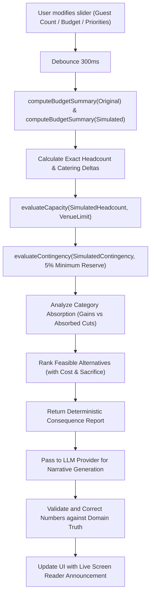

# Architecture & System Design — Celebration & Event Planner

## 1. Architectural Philosophy: Deterministic Math, Generative Language

The fundamental principle governing this application is:
> **All arithmetic that affects money, capacity, or dates MUST be computed in pure TypeScript functions. The LLM must never be the source of truth for a number.**

When planning high-stakes celebrations, a single miscalculated head count or budget hallucination causes catastrophic real-world failure (e.g. running out of plated entrees or getting shut down by local fire marshals). 

To ensure mathematical precision, the system strictly separates responsibility:
1. **Domain Engine**: Pure, deterministic TypeScript functions compute allocations, unit costs, headcount deltas, capacity margins, countdown days, and contingency reserves.
2. **Generative Intelligence**: The LLM receives immutable computed facts and synthesizes empathetic, nuanced advice, context-aware trade-off narratives, and professional vendor correspondence.
3. **Validator Gate**: A verification layer reviews every number in model outputs against computed facts, overriding or discarding discrepancies.

---

## 2. Layered Architecture

```
+--------------------------------------------------------------------------+
|                            PRESENTATION LAYER                            |
|  - App Router: app/page.tsx, app/events/[id]/..., app/events/new         |
|  - Components: BudgetSimulatorClient, TimelineClient, VendorClient      |
|  - Accessible Primitives: Modal (Focus trap/Esc), SkipToContent, Tabs    |
+------------------------------------+-------------------------------------+
                                     |
                                     v
+--------------------------------------------------------------------------+
|                              API LAYER                                   |
|  - Routes: /api/events, /api/simulate, /api/vendors/draft-message, ...  |
|  - Zod Request/Response Boundary Validation                              |
|  - Sliding-Window In-Memory Rate Limiting (checkRateLimit)              |
+------------------------------------+-------------------------------------+
                                     |
                                     v
+--------------------------------------------------------------------------+
|                             DOMAIN LAYER                                 |
|  - lib/domain/budget.ts    (Pure allocation & contingency logic)        |
|  - lib/domain/capacity.ts  (Venue limits & fire code warnings)          |
|  - lib/domain/simulator.ts (Deltas, category absorption, alternatives)   |
|  - lib/domain/timeline.ts  (UTC backwards date math & phases)           |
|  - lib/domain/intake.ts    (Adaptive interview state machine)           |
+------------------+------------------------------------+------------------+
                   |                                    |
                   v                                    v
+------------------------------------+   +---------------------------------+
|              AI LAYER              |   |        DATA PERSISTENCE         |
|  - lib/ai/provider.ts              |   |  - lib/data/repositories/       |
|  - lib/ai/deterministic-planner.ts |   |    prisma-event-repository.ts   |
|  - lib/ai/prompts.ts               |   |  - lib/data/db.ts (PrismaClient)|
|  - lib/ai/validator.ts             |   |  - SQLite (file:./dev.db)       |
|  - lib/ai/schemas.ts               |   +---------------------------------+
+------------------------------------+
```

### Module Responsibilities

1. **`app/`**: User interface and server-side route handlers. Contains zero raw arithmetic; delegates directly to domain functions or API endpoints.
2. **`lib/domain/`**: Pure functions with zero I/O or network dependencies. Easily unit-tested with 100% determinism.
3. **`lib/ai/`**: Provider abstractions, prompt templates with explicit `<computed_facts>` and `<user_data>` delimiters, Zod schemas, repair retries, offline fallback, and mathematical validation.
4. **`lib/data/`**: Swappable repository layer (`IEventRepository`) shielding the domain from SQLite and Prisma implementation details.
5. **`lib/config/`**: Centralized taxonomy, baseline allocation tables, timeline lead times, and security constants.
6. **`lib/utils/`**: Helpers for rate limiting, Tailwind class merging, currency/date formatting.

---

## 3. Decision-Support & Trade-Off Algorithm

The core differentiator of Northstar is the decision-support simulator in `lib/domain/simulator.ts`.

### Mathematical Process:



### Detailed Steps:

1. **Baseline & Priority Weighting**:
   - Each event type has a base allocation distribution (e.g. Catering 35%, Venue 22%, Photo 12%).
   - Stated user priorities (ranked 1..N) apply a linear multiplier to top categories ($+35\%$ for #1, scaling down).
   - The minimum contingency reserve floor ($5\%$) is strictly preserved before normalizing the pool.

2. **Deltas & Category Absorption**:
   - $\Delta_{\text{guests}} = \text{Guest}_{\text{sim}} - \text{Guest}_{\text{orig}}$.
   - Unit catering cost is fixed based on baseline requirements: $\text{CostPerHead} = \frac{\text{Catering}_{\text{orig}}}{\text{Guest}_{\text{orig}}}$.
   - Direct catering delta: $\Delta_{\text{catering}} = \Delta_{\text{guests}} \times \text{CostPerHead}$.
   - Categories that suffer cuts to absorb headcount or budget decreases are flagged with exact dollar absorptions.

3. **Constraint Violations**:
   - **Capacity Breach**: If $\text{Guest}_{\text{sim}} > \text{VenueCapacity}$, excess guests are calculated and a critical fire-code warning is attached.
   - **Contingency Depletion**: If $\text{Contingency}_{\text{sim}} < 0.05 \times \text{Budget}_{\text{sim}}$, emergency resilience is compromised.

4. **Feasible Alternatives Formulation**:
   Every generated alternative includes 4 mandatory fields:
   - `costImpact`: Exact dollar figure.
   - `tradeOff`: What is gained.
   - `sacrifice`: What must be cut or compromised.
   - `feasibilityScore`: Ranked score (1–100).
   - `recommendedAction`: Concrete tactical next step.

---

## 4. Provider Abstraction & Offline Zero-Config Execution

```typescript
export interface LLMProvider {
  readonly providerName: string;
  readonly isDemoMode: boolean;

  generateSimulationNarrative(
    input: SimulationNarrativeInput
  ): Promise<SimulationNarrativeOutput>;

  generateVendorDraft(
    input: VendorDraftInput
  ): Promise<VendorDraftOutput>;
}
```

- When `OPENAI_API_KEY` is not present, `getLLMProvider()` automatically instantiates `DeterministicRuleBasedPlanner`.
- The rule-based planner implements the identical interface and conforms to the exact same Zod schema, ensuring offline testability and evaluation with zero configuration.
- In production with an API key, `OpenAICompatibleProvider` calls the API with strict timeouts, retries once on schema error with a repair prompt, and falls back to `DeterministicRuleBasedPlanner` if network or repair fails.
